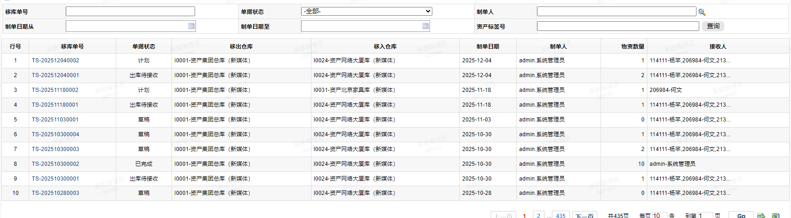
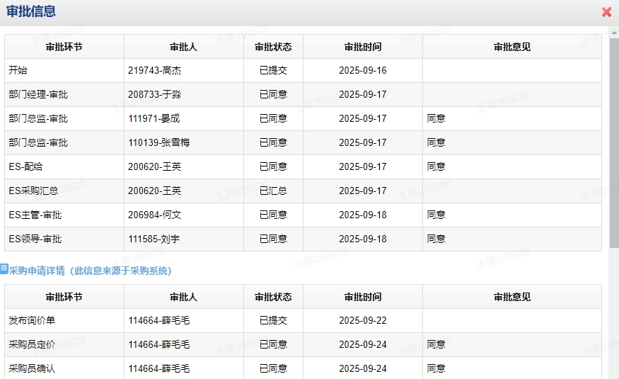
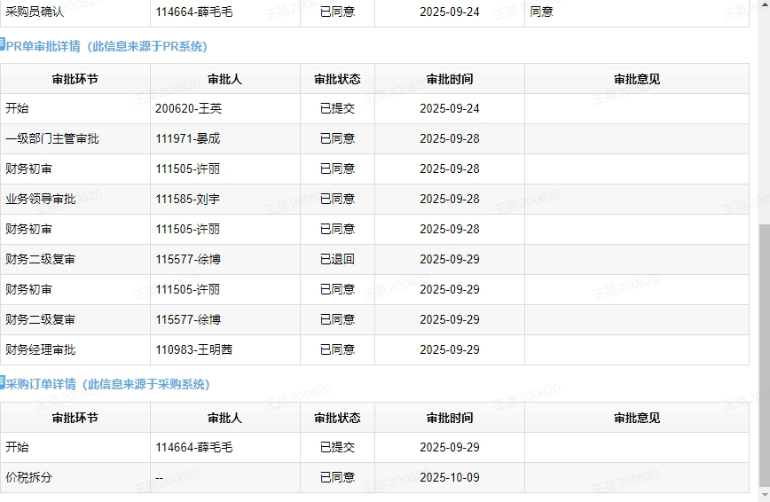

# 后台报表\&申请

## 资产明细报表（all）

### **功能说明**

1. 权限：

    1. 设置报表查看权限，并且根据登录申请人查看资产卡片的权限过滤查看报表数据权限。

    2. 集团、上海媒体分公司、广州媒体分公司各自台账的数据。

2. 入口：资产系统。

3. 取数来源：资产卡片\.资产标签号

4. 排序规则：先按照资产大类编码升序，然后按照资产小类编码升序。

5. 支持Excel导出。

### **字段**

1. 查询条件字段说明

|**字段名称**|**字段说明**|
|---|---|
|资产类别|引用物料分类基础资料 过滤资产大类和资产小类 支持多选|
|资产状态|引用资产状态基础资料 支持多选|
|资产标签号|引用卡片基础资料 过滤资产卡片 支持多选|
|序列号||
|资产说明||
|采购日期从||
|采购日期至||
|成本中心|引用成本中心基础资料 支持多选|
|启用日期从||
|启用日期至||
|公司|引用业务单元基础资料 过滤财务公司 支持多选|
|报废日期从||
|报废日期至||
|资产所属板块|引用板块基础资料 支持多选|
|资产责任人工号|引用人员基础资料 支持多选|
|HR部门|引用行政组织基础资料 支持多选|
|仓库|引用仓库基础资料 支持多选|
|City|引用City基础资料 支持多选|
|Building|引用Building基础资料 过滤所选City下Building 支持多选|
|Floor|引用Floor基础资料 支持多选|
|资产配置||
|备注||
|品牌|引用品牌基础资料 支持多选|
|原值|资产系统的原值，两位小数|
|净值|两位小数|
|资产用途|枚举值：68\-专业用途、69\-其他用途、70\-员工用机、73\-部门公用、99\- 支持多选 |
|级别|枚举值：标配非技术主机、标配技术主机、标配非技术笔记本、标配技术笔记本、标配显示器、设计显示器、特配机\-工作站、特配机\-苹果机、高端照摄像器材、中低端照摄像器材 支持多选|
|报废状态|枚举值：已报废、未报废 存在报废日期为已报废，不存在报废日期为未报废 支持多选|
|NO位置||
|PR单号||
|PO单号||
|主资产标签号|引用卡片基础资料 过滤资产卡片 支持多选|

2. 查询结果字段说明

|**字段名称**|**字段说明**|
|---|---|
|库房|仓库编码\+‘\.’\+仓库名称|
|资产大类|资产大类名称|
|资产小类|资产小类名称|
|资产小类A|资产小类名称\-之前部分|
|资产小类明细|资产小类名称\-之后部分|
|资产标签号|资产标签号|
|序列号|序列号|
|品牌|品牌名称|
|型号|资产说明‘\.’之后部分|
|级别|级别名称|
|资产说明|资产说明|
|配置|配置|
|备注|备注|
|数量|数量|
|单位|计量单位名称|
|采购日期|购买日期|
|启用日期|启用日期|
|原值|资产系统原值，两位小数|
|EBS资产原值|EBS资产原值，两位小数|
|是否有差异|原值\-EBS资产原值=0时显示“否”，否则显示“是”|
|累计折旧|EBS资产累计折旧，两位小数|
|净值|EBS资产净值，两位小数|
|折旧月数|折旧年限\*12|
|资产用途|资产用途名称|
|使用说明|使用说明|
|资产状态|资产状态名称|
|资产标记|资产标记名称|
|资产责任人工号|责任人信息\.员工工号|
|资产责任人姓名|责任人信息\.员工姓名|
|成本中心|成本中心编码\+‘\.’\+成本中心名称|
|公司|财务公司编码\+‘\.’\+财务公司名称|
|财务核算板块|财务核算板块编码\+‘\.’\+财务核算板块名称|
|资产所属板块|资产所属板块编码\+‘\.’\+资产所属板块名称|
|费用账户|费用账户|
|子公司|截取部门级次为2的部分|
|HR一级部门|截取部门级次为3的部分|
|HR二级部门|截取部门级次为4的部分|
|HR三级部门|截取部门级次为5的部分|
|HR四级部门|截取部门级次为6的部分|
|City|City名称|
|Building|Building名称|
|Floor|Floor名称|
|NO位置|NO位置|
|服务|NO服务名称|
|资产账簿|资产账簿名称|
|资产编号|资产编号|
|申请单号|申请单号|
|PO单号|PO单号|
|PR单号|PR单号|
|入库单号|入库单号|
|批次号|申请批次|
|新增类型|新增类型名称|
|主资产标签号|主资产标签号|
|物料编码|物料编码|
|报废类型|报废类型名称|
|报废日期|报废日期|
|报废原因|报废原因|
|折旧年限|折旧年限|
|折旧剩余月份|折旧剩余月份|
|ES实物报废期|ES实物报废期至（依据员工耗材申请）|
|升级金额|升级金额，两位小数|
|升级日期|升级日期|

## 资产新增报表\(王英、刘建）

### **功能说明**

1. 权限：

    1. 设置报表查看权限，并且根据登录申请人查看资产卡片的权限过滤查看报表数据权限。

    2. 集团、上海媒体分公司、广州媒体分公司各自台账的数据。

2. 入口：资产系统。

3. 取数来源：入库单\.资产标签号。

4. 过滤条件：单据状态为“已完成”（入库单执行入库后），并且入库类型=新增入库/采购接收/自购入库，资产总类为资产。

5. 排序规则：依次按照资产大类、资产小类、公司编码、板块编码、资产标签号升序。

6. 特殊说明：报表取值为入库完成时节点，之后数据不更新。

7. 支持Excel导出。

### **表单页面字段**

1. 查询条件字段说明

|**字段名称**|**字段说明**|
|---|---|
|资产类别|引用物料分类基础资料 过滤资产大类和资产小类 支持多选|
|资产标签号|引用卡片基础资料 过滤资产卡片 支持多选|
|序列号||
|资产说明||
|采购日期从||
|采购日期至||
|成本中心|引用成本中心基础资料 支持多选|
|启用日期从||
|启用日期至||
|公司|引用业务单元基础资料 过滤财务公司 支持多选|
|资产所属板块|引用板块基础资料 支持多选|
|资产责任人工号|引用人员基础资料 支持多选|
|仓库|引用仓库基础资料 支持多选|
|新增类型|引用新增类型基础资料 支持多选|
|PR单号||
|PO单号||

2. 查询结果字段说明

|字段名称|字段说明|
|---|---|
|PO单号|PO单号|
|资产大类|资产大类名称|
|资产小类|资产小类名称|
|资产说明|资产说明|
|配置|配置|
|数量|数量|
|原值|原值，两位小数|
|税金|税金，两位小数|
|含税金额|合计，两位小数|
|采购日期|购置日期|
|启用日期|启用日期|
|使用说明|使用说明|
|PR单号|PR单号|
|资产标签号|资产标签号|
|服务|NO服务名称|
|主资产标签号|主资产标签号|
|NO位置|NO位置|
|品牌|品牌名称|
|单位|计量单位名称|
|级别|资产级别名称|
|序列号|SN号|
|申请单号|申请单号|
|入库单号|单据编号|
|批次号|申请批次|
|入库类型|入库类型名称|
|新增类型|新增类型名称|
|库房|仓库编码\+‘\.’\+仓库名称|
|公司|公司编码\+‘\.’\+公司名称|
|财务核算板块|板块编码\+‘\.’\+板块名称|
|资产所属板块|板块编码\+‘\.’\+板块名称|
|资产责任人工号|责任人\.员工工号|
|资产责任人姓名|责任人\.员工姓名|
|成本中心|成本中心编码\+‘\.’\+成本中心名称|
|费用账户|费用账户|
|资产账簿|根据板块自动带出资产账簿名称|
|备注|备注|

## 资产事务报表（all）

### **功能说明**

1. 权限：

    1. 设置报表查看权限，并且根据登录申请人查看资产卡片的权限过滤查看报表数据权限。

    2. 集团、上海媒体分公司、广州媒体分公司各自台账的数据。

2. 入口：资产系统。

3. 取数来源：资产变更单，联查对应资产变更申请单，联查对应申请单。

4. 过滤条件：单据状态为“已处理”，并且资产总类为资产。

5. 报表维度：资产变更单\.资产标签号。

6. 排序规则：按照处理日期（单据审核日期），最新的显示在最上方。

7. 特殊说明：报表取值为变更完成时点数，之后数据不更新。

8. 支持Excel导出。

### **表单页面字段**

1. 查询条件字段说明

|**字段名称**|**字段说明**|
|---|---|
|资产类别 |引用物料分类基础资料 过滤资产大类和资产小类 支持多选|
|单据编号||
|单据类型|枚举值：资产转移、库存转移、出库单、入库单、资产变更、资产报废 支持多选|
|事务类型|枚举值：10\-采购新增、13\-调账新增、15\-报废新增、93\-NO位置变更、92\-资产担保人变更、20\-领用出库、21\-借用出库、24\-移库出库、25\-移库入库、30\-退库、40\-转移、70\-报废、71\-调账报废、80\-处置变卖、81\-处置捐献、82\-处置再利用、101\-升级、102\-NO主备变更、103\-延长报废期、104\-序列号变更、105\-资产位置变更、107\-使用说明备注变更、108\-资产标记变更、109\-成本中心变更、110\-资产用途变更、111\-合约号码信息变更、112\-转移新增、113\-收购新增、114\-赠与新增、115\-再利用新增 支持多选|
|资产说明||
|板块 |引用板块基础资料 支持多选|
|资产标签号|引用卡片基础资料 过滤资产卡片 支持多选|
|公司|引用业务单元基础资料 过滤财务公司 支持多选|
|事务处理日期从||
|事务处理日期至||
|资产状态 |引用资产状态基础资料 支持多选|
|事务执行人 |引用人员基础资料 支持多选|

2. 查询结果字段说明

|**字段名称**|**字段说明**|
|---|---|
|事务处理日期|审核日期|
|单据编号|单据编号|
|单据类型|单据类型名称 根据单据编号获取单据编码和名称 单据名称=转移单时，单据类型为“资产转移”； 单据名称=移库发起单/移库接收单时，单据类型为“库存转移”； 单据名称=出库单时，单据类型为“出库单”； 单据名称=入库单时，单据类型为“入库单”； 单据名称=资产变更申请单时，单据类型为“资产变更”；|
|事务类型|操作类型名称|
|事务执行人|审核人工号\+‘\.’\+审核人姓名|
|申请单号|申请单号|
|公司|财务公司编码\+‘\.’\+财务公司名称|
|财务核算板块|财务核算板块编码\+‘\.’\+财务核算板块名称|
|资产所属板块|资产所属板块编码\+‘\.’\+资产所属板块名称|
|资产标签号|资产标签号|
|资产说明|资产说明|
|单位|计量单位名称|
|数量|数量|
|启用日期|启用日期|
|资产大类|资产大类名称|
|资产小类|资产小类名称|
|资产状态|资产状态名称|
|原仓库|单据类型=“库存转移”时取值 原仓库编码\+‘\.’\+原仓库名称|
|现仓库|单据类型=“库存转移”时取值 仓库编码\+‘\.’\+仓库名称|
|原序列号|事务类型=“序列号变更”时取值 联查对应资产变更申请单\.变更前序列号|
|现序列号|事务类型=“序列号变更”时取值 联查对应资产变更申请单\.变更后序列号|
|原资产用途|事务类型=“资产用途变更”时取值 联查对应资产变更申请单\.变更前资产用途|
|现资产用途|事务类型=“资产用途变更”时取值 联查对应资产变更申请单\.变更后资产用途|
|原资产责任人|单据类型=“资产转移”时取值 原资产责任人工号\+‘\.’\+原资产责任人姓名|
|原资产责任人部门|单据类型=“资产转移”时取值 原资产责任人部门编码\+‘\.’\+原资产责任人部门名称|
|现资产责任人|单据类型=“资产转移”时取值 责任人工号\+‘\.’\+责任人姓名|
|现资产责任人部门|单据类型=“资产转移”时取值 部门编码\+‘\.’\+部门名称|
|原成本中心|事务类型=“成本中心变更”时取值 联查对应资产变更申请单\.变更前成本中心|
|现成本中心|事务类型=“成本中心变更”时取值 联查对应资产变更申请单\.变更后成本中心|
|原City|事务类型=“NO位置变更/资产位置变更”时取值 联查对应资产变更申请单\.变更前City|
|原Building|事务类型=“NO位置变更/资产位置变更”时取值 联查对应资产变更申请单\.变更前Building|
|原Floor|事务类型=“NO位置变更/资产位置变更”时取值 联查对应资产变更申请单\.变更前Floor|
|现City|事务类型=“NO位置变更/资产位置变更”时取值 联查对应资产变更申请单\.变更后City|
|现Building|事务类型=“NO位置变更/资产位置变更”时取值 联查对应资产变更申请单\.变更后Building|
|现Floor|事务类型=“NO位置变更/资产位置变更”时取值 联查对应资产变更申请单\.变更后Floor|
|原使用说明|事务类型=“使用说明备注变更”时取值 联查对应资产变更申请单\.变更前使用说明|
|现使用说明|事务类型=“使用说明备注变更”时取值 联查对应资产变更申请单\.变更后使用说明|
|原备注|事务类型=“使用说明备注变更”时取值 联查对应资产变更申请单\.变更前备注|
|现备注|事务类型=“使用说明备注变更”时取值 联查对应资产变更申请单\.变更后备注|
|原资产标记|事务类型=“资产标记变更”时取值 联查对应资产变更申请单\.变更前资产标记|
|现资产标记|事务类型=“资产标记变更”时取值 联查对应资产变更申请单\.变更后资产标记|
|原NO位置|事务类型=“NO位置变更”时取值 联查对应资产变更申请单\.变更前NO位置|
|现NO位置|事务类型=“NO位置变更”时取值 联查对应资产变更申请单\.变更后NO位置|
|原资产担保人|事务类型=“资产担保人变更”时取值 原资产担保人工号\+‘\.’\+原资产担保人姓名|
|现资产担保人 |事务类型=“资产担保人变更”时取值 资产担保人工号\+‘\.’\+资产担保人姓名|
|业务原因|联查对应申请单 申请单\.原因|

## 资产报废报表（晓丹、小静）

### **功能说明**

1. 权限：

    1. 设置报表查看权限，并且根据登录申请人查看资产卡片的权限过滤查看报表数据权限。

    2. 集团、上海媒体分公司、广州媒体分公司各自台账的数据。

2. 入口：资产系统。

3. 取数来源：资产卡片。

4. 过滤条件：资产总类为资产，并且资产状态为“已报废\-待处置”或“已报废\-已处置”。

5. 报表维度：资产卡片\.资产标签号。

6. 排序规则：按照报废日期，最新的显示在最上方。

7. 特殊说明：报表取值为报废完成时点数，之后数据不更新。

8. 支持Excel导出。

### **表单页面字段**

1. 查询条件字段说明

|**字段名称**|**字段说明**|
|---|---|
|资产类别|引用物料分类基础资料 过滤资产大类和资产小类 支持多选|
|资产标签号||
|序列号||
|资产说明||
|成本中心|引用成本中心基础资料 支持多选|
|启用日期从||
|启用日期至||
|公司|引用业务单元基础资料 过滤财务公司 支持多选|
|报废日期从||
|报废日期至||
|资产所属板块|引用板块基础资料 支持多选|
|资产责任人工号|引用人员基础资料 支持多选|
|City|引用City基础资料 支持多选|
|Building|引用Building基础资料 过滤所选City下Building 支持多选|
|Floor|引用Floor基础资料 支持多选|

2. 查询结果字段说明

|**字段名称**|**字段说明**|
|---|---|
|资产大类|资产大类名称|
|资产小类|资产小类名称|
|资产标签号|资产标签号|
|资产说明|资产说明|
|数量|数量|
|单位|计量单位名称|
|采购日期|购买日期|
|启用日期|启用日期|
|原值|EBS资产原值，两位小数|
|净值|EBS资产净值，两位小数|
|折旧月数|折旧年限\*12|
|资产用途|资产用途名称|
|资产状态|资产状态名称|
|资产标记|资产标记名称|
|资产责任人工号|责任人信息\.员工工号|
|资产责任人姓名|责任人信息\.员工姓名|
|成本中心|成本中心编码\+‘\.’\+成本中心名称|
|公司|财务公司编码\+‘\.’\+财务公司名称|
|财务核算板块|财务核算板块编码\+‘\.’\+财务核算板块名称|
|资产所属板块|资产所属板块编码\+‘\.’\+资产所属板块名称|
|City|City名称|
|Building|Building名称|
|Floor|Floor名称|
|主资产标签号|主资产标签号|
|报废数量||
|报废原值|两位小数|
|报废净值|两位小数|
|报废类型|报废类型名称|
|报废原因|报废原因|
|报废日期|报废日期|
|处置类型||
|备注|备注|
|升级日期|升级日期|
|升级金额|升级金额，两位小数|

## 新员工领用报表（杨芊）

### **功能说明**

1. 权限：

    1. 设置报表查看权限，并且根据登录申请人查看资产卡片的权限过滤查看报表数据权限。

    2. 集团、上海媒体分公司、广州媒体分公司各自台账的数据。

2. 入口：资产系统。

3. 取数来源：新员工领用单，联查对应出库单。

4. 过滤条件：无。

5. 报表维度：新员工领用单\.资产标签号。

6. 排序规则：按照处理日期，最新的显示在最上方。

7. 支持Excel导出。

### **表单页面字段**

1. 查询条件字段说明

|**字段名称**|**字段说明**|
|---|---|
|~~领用状态~~|~~枚举值：领用、弃领、延期~~ ~~支持多选~~|
|资产类别 |引用物料分类基础资料 过滤资产大类和资产小类 支持多选|
|~~资产状态~~|~~引用资产状态基础资料~~ ~~支持多选~~|
|资产标签号 |引用卡片基础资料 过滤资产卡片 支持多选|
|序列号||
|资产说明||
|入职日期从||
|入职日期至||
|领用日期从||
|领用日期至||
|公司|引用业务单元基础资料 过滤财务公司 支持多选|
|资产责任人工号|引用人员基础资料 支持多选|
|HR部门|引用行政组织基础资料 支持多选|

2. 查询结果字段说明

|**字段名称**|**字段说明**|
|---|---|
|申请单号|领用单号|
|单据状态|单据状态名称|
|领用状态|领用状态名称|
|资产责任人工号|使用人\.员工工号|
|资产责任人姓名|使用人\.员工姓名|
|入职日期|入职日期|
|PS配置|HR分配配置名称|
|办公地点|办公区名称|
|City|City名称|
|Building|Building名称|
|Floor|Floor名称|
|~~领用说明~~|~~固定“新员工入职领用”~~|
|是否领用|存在出库单号为“是”，不存在出库单号为“否”|
|领用日期|领用日期|
|是否刷卡|联查对应出库单\.员工确认方式 员工确认方式=刷卡为“是”，员工确认方式\<\>刷卡为“否”|
|~~是否签字~~|~~联查对应出库单\.是否签字~~|
|资产标签号|资产标签号|
|序列号|序列号|
|资产说明|资产说明|
|备注|资产备注|
|数量|固定为1|
|单位|资产标签号\.计量单位名称|
|原值|资产系统原值，两位小数|
|启用日期|资产标签号\.启用日期|
|资产状态|资产状态名称|
|公司|财务公司编码\+‘\.’\+财务公司名称|
|板块|资产所属板块编码\+‘\.’\+资产所属板块名称|
|部门|部门编码\+‘\.’\+部门长名称|
|费用账户|费用账户|

## 资产统一申请领用报表（王英、杨芊、志强）

### **功能说明**

1. 权限：

    1. 设置报表查看权限，并且根据登录申请人查看资产卡片的权限过滤查看报表数据权限。

    2. 集团、上海媒体分公司、广州媒体分公司各自台账的数据。

2. 入口：资产系统。

3. 取数来源：资产配给单，联查对应资产申请单，联查对应资产统一汇总申请单，联查对应资产领用单，联查对应资产出库单。

4. 过滤条件：无。

5. 报表维度：

    1. 匹配状态选择“库存领用”：不存在资产标签号（资产配给单和对应资产领用单上都不存在资产标签号）时，维度是资产配给单\.物料；存在资产标签号（资产配给单或对应资产领用单）时，维度是资产配给单\.物料\.数量，按数量为1拆行显示（如果只有资产配给单上存在，以资产配给单\.资产标签号为准，如果对应资产领用单上存在，以资产领用单\.资产标签号为准）。

    2. 匹配状态选择“统一采购”：不存在PO单信息时，维度是资产配给单\.物料；存在PO单信息时，维度是资产配给单\.物料\.数量，按数量为1拆行显示。

6. 排序规则：按照申请日期，最新的显示在最上方。

7. 支持Excel导出。

### **表单页面字段**

1. 查询条件字段说明

|**字段名称**|**字段说明**|
|---|---|
|申请单号||
|申请人办公区|引用办公区基础资料 支持多选|
|部门|引用行政组织基础资料 支持多选|
|汇总提交人名称|引用人员基础资料 支持多选|
|是否超标|枚举值：是、否|
|资产类别|引用物料分类基础资料 过滤资产大类和资产小类 支持多选|
|申请日期从||
|申请日期至||
|资产标签号|引用卡片基础资料 过滤资产卡片 支持多选|
|资产说明||
|资产配给单号||
|资产统一汇总单号||
|申请人|引用人员基础资料 支持多选|

2. 查询结果字段说明

|**字段名称**|**字段说明**|
|---|---|
|申请单号|申请单号|
|申请日期|申请日期|
|统一申请单状态|联查对应资产申请单\.单据状态|
|申请人|申请人工号\+‘\.’\+申请人姓名|
|申请人部门|部门编码\+‘\.’\+部门名称|
|申请人办公区|办公区名称|
|资产总类|物料编码\.资产总类名称|
|物料编码|物料编码|
|资产名称|物料名称|
|申请数量|数量|
|申请原因|申请原因|
|详细说明|详细说明|
|是否超标|是否个人超标|
|资产配给单号|单据编号|
|资产统一汇总单号|联查对应资产统一汇总申请单\.单据编号|
|子流程类型|采购、采购汇总、领用 ①资产配给单匹配状态选择库存领用时，子流程类型为领用 ②资产配给单匹配状态选择统一采购并且不存在“资产统一汇总单号”时，子流程类型为采购 ③资产配给单匹配状态选择统一采购并且存在“资产统一汇总单号”时，子流程类型为采购汇总|
|审批节点|联查对应资产申请单\.当前审批节点，只取资产系统的审批节点|
|当前审批人|当前审批节点的审批人，取一个显示 审批人工号\+‘\.’\+审批人姓名|
|参考单价|参考单价，两位小数|
|预计采购金额|当匹配状态选择“统一采购”时取值 数量\*参考单价，两位小数|
|汇总提交人|联查对应资产统一汇总申请单 汇总提交人工号\+‘\.’\+汇总提交人姓名|
|ES建议|存在“资产统一汇总单号”时，取对应资产统一汇总申请单\.ES建议；不存在时，取资产配给单\.ES建议|
|采购申请单号|从采购系统中获取对应采购申请单号|
|采购申请状态|从采购系统中获取对应采购申请状态|
|PO单号|从采购系统中获取对应PO单号|
|PO状态|从采购系统中获取对应PO状态|
|实际采购金额|从采购系统中获取对应采购含税单价|
|完成时间|联查对应资产出库单\.审核日期|
|是否弃领|联查对应资产领用单\.是否弃领|
|领用出库单号|联查对应资产出库单\.单据编号|
|出库日期|联查对应资产出库单\.审核日期|
|员工确认方式|联查对应资产出库单\.员工确认方式|
|是否手签|联查对应资产出库单\.是否签字|
|资产标签号|如果只有资产配给单上存在资产标签号，取资产配给单\.资产标签号，如果对应资产领用单上存在资产标签号，取对应资产领用单\.资产标签号|
|资产大类|资产标签号\.资产大类名称|
|资产小类|资产标签号\.资产小类名称|
|资产说明|资产标签号\.资产说明|
|领用数量|联查对应资产出库单\.数量|
|使用说明|资产标签号\.使用说明|

## 耗材统一申请领用报表（刘建）

### **功能说明**

1. 权限：

    1. 设置报表查看权限，并且根据登录申请人查看资产卡片的权限过滤查看报表数据权限。

    2. 集团、上海媒体分公司、广州媒体分公司各自台账的数据。

2. 入口：资产系统。

3. 取数来源：耗材配给单，联查对应耗材申请单，联查对应耗材统一汇总申请单，联查对应耗材领用单。

4. 过滤条件：物资总类为低值耐用品、耗材。

5. 报表维度：耗材配给单\.物料。

6. 排序规则：按照申请日期，最新的显示在最上方。

7. 支持Excel导出。

### **表单页面字段**

1. 查询条件字段说明

|**字段名称**|**字段说明**|
|---|---|
|申请单号||
|耗材类别|引用物料分类基础资料 过滤耗材大类和耗材小类 支持多选|
|是否弃领|枚举值：是、否 支持多选|
|统一申请单状态 |枚举值：处理中、已处理、已驳回 支持多选|
|耗材物料编码||
|申请日期从||
|申请日期至||
|申请人|引用人员基础资料 支持多选|
|申请人部门|引用行政组织基础资料 支持多选|
|申请人办公区|引用办公区基础资料 支持多选|
|耗材名称|引用物料基础资料 过滤耗材物料 支持多选|

2. 查询结果字段说明

|**字段名称**|**字段说明**|
|---|---|
|申请单号|申请单号|
|申请日期|申请日期|
|申请人|申请人工号\+‘\.’\+申请人姓名|
|申请人部门名称|部门编码\+‘\.’\+部门长名称|
|申请人办公区|办公区名称|
|统一申请单状态|联查对应耗材申请单\.单据状态|
|匹配状态|匹配状态名称|
|~~驳回类型~~|~~驳回类型名称~~|
|耗材总类名称|物料编码\.资产总类名称|
|物料编码|物料编码|
|耗材名称|物料名称|
|申请原因|申请原因|
|详细说明|详细说明|
|耗材配给单号|单据编号|
|配给单审核完成时间|审核日期|
|耗材统一汇总单号|联查对应耗材统一汇总申请单\.单据编号|
|审批节点|联查对应耗材申请单、配给单、汇总单\.当前审批节点，只取资产系统的审批节点|
|当前审批人名称|当前审批节点的审批人，取一个显示 审批人工号\+‘\.’\+审批人姓名|
|申请数量|数量|
|参考单价|参考单价，两位小数|
|预计采购金额|数量\*参考单价，两位小数|
|汇总提交人名称|联查对应耗材统一汇总申请单 汇总提交人工号\+‘\.’\+汇总提交人姓名|
|ES建议|联查对应耗材统一汇总申请单\.ES建议|
|采购申请单号|从采购系统中获取对应采购申请单号|
|采购申请状态|从采购系统中获取对应采购申请状态|
|PO单号|从采购系统中获取对应PO单号|
|PO状态|从采购系统中获取对应PO状态|
|采购数量|从采购系统中获取对应采购数量|
|采购单价|从采购系统中获取对应采购单价|
|采购金额|从采购系统中获取对应采购金额|
|是否弃领|联查对应耗材领用单\.是否弃领|
|领用出库单号|联查对应耗材出库单\.单据编号|
|出库日期|联查对应耗材出库单\.审核日期|
|员工确认方式|联查对应耗材出库单\.员工确认方式名称|
|~~是否手签~~|~~联查对应耗材出库单\.是否签字~~|
|耗材大类名称|物料编码\.耗材大类名称|
|耗材小类名称|物料编码\.耗材小类名称|
|领用数量|联查对应耗材出库单\.数量|

## 耗材明细报表（刘建）

### **功能说明**

1. 权限：

    1. 设置报表查看权限，并且根据登录申请人查看资产卡片的权限过滤查看报表数据权限。

    2. 集团、上海媒体分公司、广州媒体分公司各自台账的数据。

2. 入口：资产系统。

3. 取数来源：耗材配给单，联查对应耗材申请单，联查对应耗材统一汇总申请单，联查对应耗材领用单。

4. 过滤条件：物资总类为低值耐用品、耗材。

5. 报表维度：低值耐用品：耗材卡片\.耗材标签号；耗材：耗材领用单\.物料。

6. 排序规则：先按照耗材大类编码升序，然后按照耗材小类编码升序。

7. 支持Excel导出。

### **字段**

1. 查询字段

2. 表单字段

## 系统页面仪表盘（纯新增文姐）

### 功能说明

1. 权限：

    1. 设置报表查看权限，并且根据登录申请人查看资产卡片的权限过滤查看报表数据权限。

    2. 集团、上海媒体分公司、广州媒体分公司各自台账的数据。

2. 入口：资产系统。

3. 以分析图表方式展示资产台账变化：

    1. 资产概况（按资产大类，分别展示各子公司下在库和在用的数量及占总量百分比、原值及占总原值百分比、净值及占总净值百分比）

    2. 耗材采购概况（按耗材大类，分别展示各子公司下采购数量、金额）

    3. 库存资产闲置情况（展示笔记本、主机、显示器、移动数码、照摄像器材、其他办公资产在库数量以及滞留天数）

    4. 展示子公司下技术及非技术部门的电脑持有情况（资产类别：主机、笔记本；数量：各项持有量、总量；人均持有情况：一人多机、一人一机情况、人均数量等；

    5. 展示各子公司下各部门主机、笔记本、显示器、照摄像器材、移动数码等资产的使用情况（按资产折旧年限区分到期、未到期）；

    6. 各办公区办公类资产情况（主机、笔记本、显示器、照摄像器材、移动数码员工在用、公共在用、在库）；

    7. 按集团、分公司各自台账对应的资产业务量及各类业务单据的完成时效进行统计。

    8. 其他图表可根据系统拓展功能及业务变化进行灵活配置。

## 申请单据记录查询

### 移库单

#### **业务特殊说明**

1. 权限：系统支持按权限分配。

2. 入口：资产系统。

3. 功能：

    1. 支持Excel导出。字段同单据内容。

    2. 数据来源：

        1. 资产移库单、资产接收单。

    3. 可展示出资产移库到资产接收全流程单据数据。

    4. 数据信息按照申请时间进行排序。

    5. 查询条件：

        1. 支持通过 “移库单号”“单据状态”“制单人”“制单日期范围”“资产标签号” 等字段进行精准 / 模糊查询；

    6. 列表返回：

        1. 支持查询结果的列表展示，包含移库单号、单据状态、移出 / 移入仓库、制单日期、制单人、物资数量、接收人等核心信息。

#### **页面**

1. 移库单列表

2. 单条数据：

    #### 字段

|**字段名称**|**字段属性**|**备注**|
|---|---|---|
|移库单号|单行文本||
|单据类型|单行文本||
|单据状态|单行文本||
|移出仓库|下拉选择框||
|移入仓库|下拉选择框||
|制单日期|时间日期||
|制单人|员工选择||
|资产数量|数字||
|接收人|员工选择||
|备注|多行文本||
|子表单|子表单||
|移库状态|下拉选择框||
|资产标签号|单行文本||
|资产说明|单行文本||
|资产总类|下拉选择框||
|数量|数字||
|公司|公司||
|板块|单行文本||
|资产标记|下拉选择框||
|启用日期|时间日期||
|资产状态|下拉选择框||
|操作|按钮||
|资产标签号|||
|移库单信息|关联表单|关联资产移库表单，展示移库单号、出库仓库、出库仓库管理员|
|资产移库|关联表单|关联资产移库表单，对方仓库、入库仓库管理员、移库资产、数量、资产标记、移库出库说明|

### 退库单

#### **业务特殊说明**

1. 权限：

    1. 系统支持通过人员、部门、公司进行权限分配。

2. 入口：

    1. 查看：易点资产系统。

3. 功能：

    1. 支持Excel导出。字段同单据内容。

    2. 数据来源：

        1. 资产退库、

    3. 可展示出资产退库全流程单据数据。

    4. 数据信息按照申请时间进行排序。

    5. 从某一单据返回后，停留在已有条件查询搜索后的页面，而不是回退到首页列表。

    6. 支持导出表单已有数据信息（包含申请人、子公司、部门、办公区等申请人信息、退库资产信息、库管员信息等）。

    7. 查询条件：

        1. 支持通过 “申请单号”“退库单号”“退库类型”“单据状态”“申请人”“仓库”“”子公司”、”部门”资产标签号”“申请时间范围” 等字段进行精准 / 模糊查询；

    8. 列表返回：

        1. 查询结果需展示退库单据的核心信息，包括申请单号、退库单号、单据状态、退库类型、审批人、申请人、申请时间、资产标签号、退库原因、物资数量、是否赔偿。可点击进入单条详情信息中，在信息中可看到审批流程。

    #### **页面**

1. 列表页：

2. 单据页：

    #### 字段

    搭建人员参考现有资产系统借用单据完成报表搭建。

|**字段名称**|**字段属性**|**备注**|
|---|---|---|
|申请单号|单行文本||
|申请人|员工选择||
|申请时间|时间日期||
|公司|公司选择||
|部门|部门选择||
|办公区|单行文本||
|板块|单行文本||
|联系电话|单行文本||
|邮箱|单行文本||
|退库单号|单行文本||
|单据状态|单行文本||
|退库类型|下拉选择框||
|MIS 鉴定|单行文本||
|退库原因|单行文本||
|审批人|员工选择||
|是否赔偿|单选框||
|资产说明|单行文本||
|SN 号|单行文本||
|资产标签号|单行文本||
|资产数量|数字||
|资产状态|单行文本||
|资产大类|下拉选择框||
|资产小类|下拉选择框||
|部件数量|数字||
|启用日期|时间日期||
|城市|下拉选择框||
|建筑|下拉选择框||
|楼层|单行文本||
|备注|单行文本||
|使用说明|单行文本||
|鉴定人|人员选择||
|鉴定日期|时间日期||
|鉴定结果|单行文本||
|附件信息|附件||
|维修记录|子表单||
|退库类型|下拉选择框||
|审批进度|审批进度||

### 转移单

#### **业务特殊说明**

1. 权限：

    1. 系统支持通过人员、部门、公司进行权限分配。

2. 入口：

    1. 查看：易点资产系统。

3. 功能：

    1. 支持Excel导出。字段同单据内容。

    2. 数据来源：

        1. 资产转移单、核心：转移单。

    3. 数据信息按照申请时间进行排序。

    4. 从某一单据返回后，停留在已有条件查询搜索后的页面，而不是回退到首页列表。

    5. 查询条件：

        1. 支持通过 “申请单号”“转移单号”“单据状态”“转出人”“接收人”“、“转出人子公司“、“转出人部门“、“转出人子公司“、“转出人部门“制单时间范围” 等字段进行精准 / 模糊查询；

    6. 列表返回：

        1. 查询结果需展示转移单据核心信息，包括申请单号、转移单号、单据状态、转出人 / 公司、接收人 / 公司、申请时间、转移类型、物资数量及进度查看入口。

#### **页面 **

1. 列表

2. 单据

    #### 字段

    搭建人员参考现有资产系统借用单据完成报表搭建。

### 借用单

#### **业务特殊说明**

1. 权限：

    1. 系统支持通过人员、部门、公司进行权限分配。

2. 入口：

    1. 查看：易点资产系统。

3. 功能：

    1. 支持Excel导出。字段同单据内容。

    2. 数据来源：

        1. 资产借用申请单、资产续借申请单。

    3. 数据信息按照申请时间进行排序。

    4. 从某一单据返回后，停留在已有条件查询搜索后的页面，而不是回退到首页列表。

    5. 查询条件：

        1. 支持通过 “申请单号”“资产出库单号”“单据状态”“资产标签号”“申请人”“制单时间范围” 等字段进行精准 / 模糊查询；查询条件增加资产标签号、子公司、部门。

    6. 列表返回：

        1. 查询结果需展示续借单据核心信息，包括单据类型、单据状态、申请人、申请时间、审批人、部门、数量及详情查看入口。

#### **页面**

1. 列表：

1. 单据

#### 字段

搭建人员参考现有资产系统借用单据完成报表搭建。

### 更换单

#### **业务特殊说明**

1. 权限：

    1. 系统支持通过人员、部门、公司进行权限分配。

2. 入口：

    1. 查看：易点资产系统。

3. 功能：

    1. 支持Excel导出。字段同单据内容。

    2. 数据来源：

        1. 资产更换申请单。

    3. 数据信息按照申请时间进行排序。

    4. 从某一单据返回后，停留在已有条件查询搜索后的页面，而不是回退到首页列表。

    5. 查询条件：

        1. 支持通过 “申请单号”“更换单号”“单据状态”“申请人”“制单时间范围” 等字段进行精准 / 模糊查询；查询条件里增加资产标签号、子公司、部门。

    6. 列表返回：

        1. 查询结果需展示转移单据核心信息，包括申请单号、单据状态、申请人 / 公司、申请时间、转移类型、资产数量及进度查看入口。

#### **页面**

#### 字段

待搭建后补充

### 未完成单据查询

#### **业务特殊说明**

1. 权限：

    1. 系统支持按照人员设置管理员进行表单查看。

2. 入口：

    1. 查看：易点资产系统。

3. 功能：

    1. 支持Excel导出。字段同单据内容。

    2. 数据来源：

        1. 资产系统中所有处于 “处理中” 状态的流程单据，均统一存储至当前表单。申请人可在当前页面，通过单据类型、单据号、申请人信息等条件进行查询，查询出数据可看到全流程信息。

        2. 每周一以Excel形式汇总当前台账内未完成的员工申请单据，通知固定人员（杨芊、王英、孙志强、刘建和何文）。

        3. 将列表按照 “生成时间” 进行排序。

#### **页面**

#### 字段

搭建人员参考现有资产系统借用单据完成报表搭建。

### 资产申请单查询

#### **业务特殊说明**

1. 权限：

    1. 系统支持通过人员、部门、公司进行权限分配。

2. 入口：

    1. 查看：易点资产系统。

3. 功能：

    1. 支持Excel导出。字段同单据内容。

    2. 数据来源：

        1. 资产申请表单、资产配给单、资产汇总单、资产领用单。

    3. 可展示出资产申请到领用全流程单据数据。

    4. 数据信息按照申请时间进行排序。

    5. 查看条件：

        1. 可根据申请单号、出库单号、单据状态、申请人、部门、子流程单号、审批节点、当前审批人、汇总提袭人、申请时间进行组合查询。

        2. **进度查看需展示本系统进度与三方系统进度，**资产汇总\-采购系统（采购系统每个节点都需要展示）。

#### **页面**

[资产申请查询\.mp4](图片和附件/资产申请查询.mp4)

#### 字段

待搭建后补充，不少于先搜狐资产管理

### 耗材申请单查询

#### **业务特殊说明**

1. 权限：

    1. 系统支持通过人员、部门、公司进行权限分配。

2. 入口：

    1. 查看：易点资产系统。

3. 功能：

    1. 按照物料拆分后显示单据。（有多个物料显示对应数量的单据）

    2. 数据来源：

        1. 耗材申请表单、耗材配给单、耗材汇总单、耗材领用单。

    3. 数据信息按照申请时间进行排序。

    4. 从某一单据返回后，停留在已有条件查询搜索后的页面，而不是回退到首页列表。

    5. 支持查看全流程审批流程信息，包含当前审批节点和当前审批人。

    6. 查看条件：

        1. 可根据申请单号、出库单号、单据状态、申请人、部门、子流程单号、审批节点、当前审批人、汇总提袭人、申请时间进行组合查询。

    7. 支持Excel导出

        1. 模板：

#### **页面**

#### 字段

搭建人员参考现有资产系统借用单据完成报表搭建。

